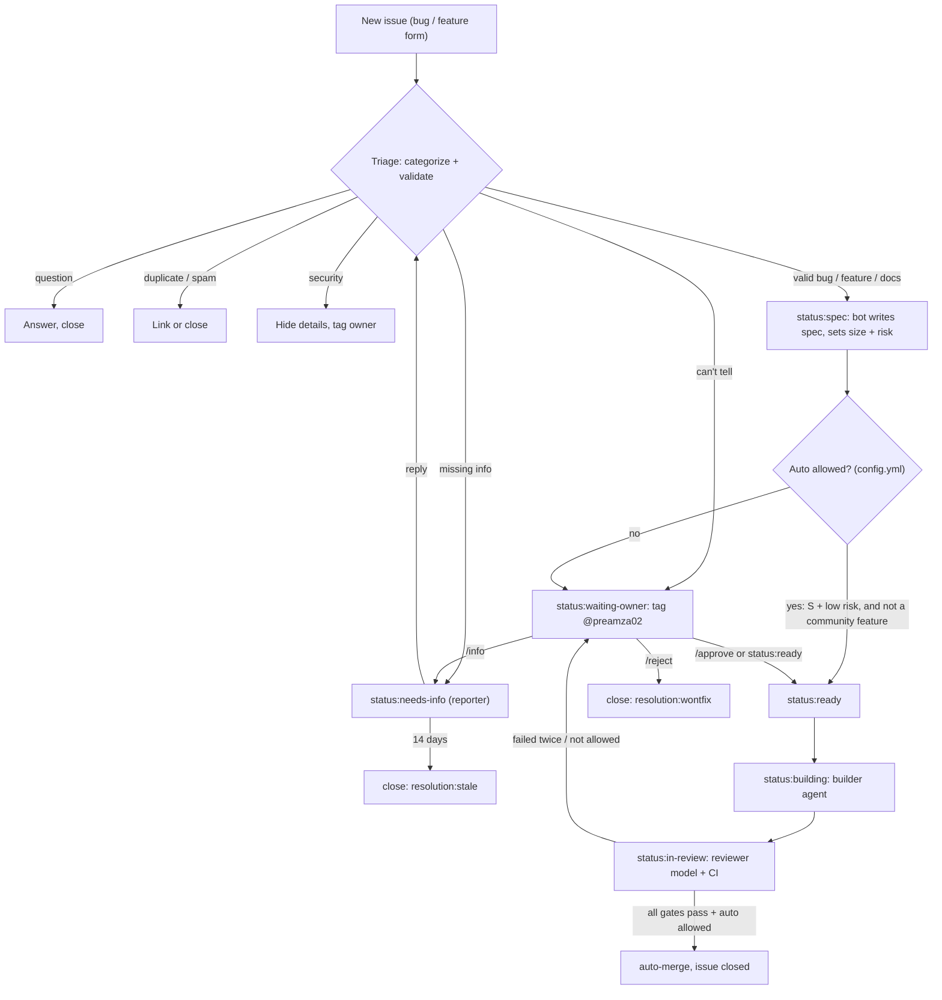

# moojot software factory 🏭🐷

An issue goes in; a merged PR (or a clear question for the owner) comes out.

## Who does what

| Stage | Trigger | Runs on | Prompt |
|---|---|---|---|
| Intake (labels, source, re-triage on reply) | issue/comment events | GitHub Actions, no AI | `.github/workflows/factory-intake.yml` |
| Owner commands | owner comments `/…` | GitHub Actions, no AI | `.github/workflows/factory-commands.yml` |
| Label move | write access adds a `status:*` label | GitHub Actions, no AI | `.github/workflows/factory-labels.yml` |
| Stale needs-info | daily | GitHub Actions, no AI | `.github/workflows/factory-stale.yml` |
| Triage | `status:triage` | AI agent | `prompts/triage.md` |
| Spec | `status:spec` | AI agent | `prompts/spec.md` |
| Build | `status:ready` | AI agent (own git checkout) | `prompts/build.md` |
| Review | `status:in-review` | AI agent (different model) | `prompts/review.md` |

## Owner commands (comment on an issue or PR)

| Command | Effect |
|---|---|
| `/approve` | Spec OK, so move to `status:ready` (the builder picks it up) |
| `/reject [reason]` | Close as `resolution:wontfix` |
| `/info [question]` | Ask the reporter, so move to `status:needs-info` |
| `/spec [notes]` | Back to `status:spec` so the bot rewrites the spec with your notes |
| `/triage` | Re-run triage |
| `/size S\|M\|L`, `/risk low\|high` | Override the bot's estimate |
| `/stop`, `/resume` | Add/remove `factory:hold` |
| `/merge` | (PR) enable auto-merge once checks pass |

Applying the `status:ready` label yourself does the same thing as `/approve`. That is the tag that sends an issue to implementation, including a community feature that stopped at spec. Anyone with write, maintain, or admin on the repo can do it. Other `status:*` labels you add become the only status, so the matching stage runs next. `type:security` never queues, and `factory:hold` still blocks the builder until `/resume`.

## Kill switch
Set the repo variable `FACTORY_PAUSED=true` (Settings → Secrets and variables → Actions → Variables).
